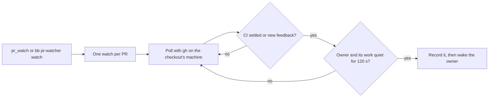

# PR Watcher

Wakes the bb thread that owns a pull request when CI settles or a reviewer
leaves feedback, with a short message saying what changed. It only wakes
threads: it never pushes, replies on GitHub or requests reviewers.



## Requirements

- bb 0.48.1 or later.
- `gh`, logged in, on the machine that holds the checkout. The plugin has no
  token of its own.
- github.com. Other hosts aren't supported.

## Use

An agent calls `pr_watch` after it opens a PR. The plugin's instructions tell
it to. Nothing is watched unless the agent or you ask.

```sh
bb pr-watcher watch                # claim the checkout's PR for this thread
bb pr-watcher watch thr_abc --pr https://github.com/acme/api/pull/42
bb pr-watcher status               # what's watched, and why a wake is held
bb pr-watcher unwatch thr_abc      # stop, and keep the thread off until `watch`
```

Each command takes `--json`. `[thread]` defaults to the calling thread.

## Settings

| Setting | Default | Notes |
| --- | --- | --- |
| `instructionLine` | `Check the failures and comments and fix what's needed locally.` | The action line near the end of every message. Cleaned to one line of at most 300 characters. The safety line after it can't be removed |
| `botAuthors` | `copilot-pull-request-reviewer, coderabbitai, claude, chatgpt-codex-connector` | Comma-separated bot logins whose reviews count. A trailing `[bot]` is ignored |

```sh
bb plugin config pr-watcher set botAuthors 'coderabbitai, my-review-bot'
bb plugin reload pr-watcher
```

Settings are read when the plugin loads, so reload after changing them.

## Behavior

- **What wakes a thread.** CI settling on a commit, pass or fail, once per
  commit. A reported failure that then passes on the same commit, once, as
  `CI now passing`. A review or comment from an `OWNER`, `MEMBER` or
  `COLLABORATOR`, and a review from a listed bot.
- **What doesn't.** Comments from your own GitHub account, bot conversation
  comments, outsiders, empty `COMMENTED` reviews, re-runs that repeat a reported
  verdict, a pass that turns into a failure on the same commit, and a PR claimed
  while failing that passes on the same commit.
- **Baseline.** A claim never reports what already exists.
- **Timing.** A wake waits for the owner and everything running under it, through
  parent and lifecycle-owner links, to be quiet for 120 seconds, and goes out on
  the next poll. Polls run every 60 seconds while CI runs or for 10 minutes after
  the owner goes idle, and every 5 minutes otherwise.
- **Ownership.** One watch per PR. A claim from another thread or environment
  takes over and keeps what was pending and reported.
- **Ending.** A watch ends on merge or close, on `unwatch`, when the environment
  is removed, or when a branch-bound watch's checkout no longer resolves to that
  PR. If the owner is archived or deleted, the nearest eligible parent in the same
  environment takes over; otherwise the watch ends.
- **Delivery.** A wake is recorded before it is sent. If a send is interrupted or
  its result is lost, the wake counts as delivered, so a rare wake can be lost but
  none is repeated.

## Limits

- Only the last 100 reviews and last 100 comments are read. If all of them are
  new, the message and `status` say feedback may be missing.
- A PR with more than 100 checks is held as `ci: unsupported` and CI is never
  reported for it. Feedback still is.

## Security

GitHub text is untrusted. Excerpts, titles and check names are cleaned, shortened
and placed between `From GitHub` and `End of GitHub data`, and the fixed safety
line tells the agent not to follow them. Logs carry PR URLs, thread ids and
counts, never comment text.

## Develop

```sh
npm install
npm run typecheck
npm test
bb plugin build
```

The design is in [`docs/specs/pr-watcher.md`](../../docs/specs/pr-watcher.md).
