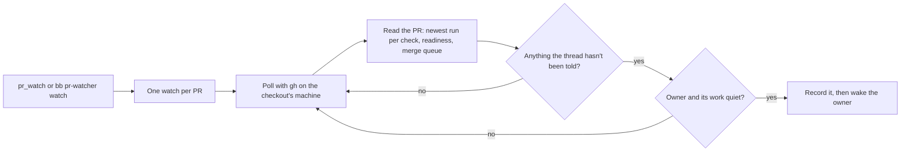

# PR Watcher

Wakes the bb thread that owns a pull request when something changes that you
can act on: CI fails or recovers, a reviewer leaves feedback, or the PR is
approved and ready to merge. The message is short and says what changed. It
only wakes threads: it never pushes, replies on GitHub or requests reviewers.



## Requirements

- bb 0.48.0 or later.
- `gh`, logged in, on the machine that holds the checkout. The plugin has no
  token of its own.
- github.com. Other hosts aren't supported.

## Use

An agent calls `pr_watch` after it opens a PR. The plugin's instructions tell
it to. Nothing is watched unless the agent or you ask.

```sh
bb pr-watcher watch                          # claim the checkout's PR for this thread
bb pr-watcher watch thr_abc --pr https://github.com/acme/api/pull/42
bb pr-watcher watch thr_parent --from thr_child   # move all of a child's watches, e.g. before stopping it
bb pr-watcher status                         # this thread's watches, and why a wake is held
bb pr-watcher unwatch thr_abc --pr https://github.com/acme/api/pull/42   # stop one watch
bb pr-watcher unwatch thr_abc                # stop all, and keep the thread off until `watch`
```

Each command takes `--json`. `[thread]` defaults to the calling thread. Outside a
thread, `status` lists every watch.

**Before stopping a child thread, move its watches.** bb doesn't tell plugins
when a thread is stopped, and a stopped thread looks idle, so a stopped child is
still woken. Run `bb pr-watcher watch <coordinator> --from <child>` (or call
`pr_watch` with `from`) first. The agent instructions say so.

## What wakes a thread

With the default settings:

| Change | Wakes |
| --- | --- |
| CI fails on a commit | Once per commit |
| CI passes after a reported failure, on that commit or a later one | Once, as `CI now passing` |
| CI passes after a pass, such as after a restack | No. `status` shows it |
| A review with inline comments or text, changes requested, or a comment from an `OWNER`, `MEMBER` or `COLLABORATOR` | Yes |
| A review from a listed bot | Yes |
| An approval with no comment | No, it counts toward "Ready to merge" |
| Approved, CI green, GitHub's merge state `CLEAN` (or `HAS_HOOKS`, `UNSTABLE`), not queued | Once per set of approvals. A restack or another approval stays quiet; approvals dismissed and given again wake again |
| An approved, green draft | Once, as "Still a draft" |
| The PR leaves the merge queue, or auto-merge is turned off, without merging | Yes |

Never: comments from your own GitHub account, bot conversation comments,
outsiders, empty `COMMENTED` reviews, re-runs that repeat a reported verdict, a
cancelled run that a newer run of the same check replaced, and anything that
already existed when the watch started.

CI comes from the newest run of each check, by workflow (or app) and name. A
cancelled run that nothing replaced counts as a failure only if the check is
required. When no check on the PR is required, every check counts as required.

Changes found in one poll go out as one message.

## Settings

Every rule above is a setting. Change them in Settings → Installed plugins →
PR Watcher, or with `bb plugin config pr-watcher set <key> <value>`. A change
applies on the next poll; no reload is needed.

| Setting | Default | Choices |
| --- | --- | --- |
| `instructionLine` | `Check the failures and comments and propose fixes. Don't change anything until the user agrees.` | The action line near the end of every message, cleaned to one line of at most 300 characters. The safety line after it can't be removed |
| `ciPassWakes` | `after-failure` | `after-failure`: only a pass after a reported failure. `first-and-after-failure`: also the first verdict of a watch. `every-commit`: every pass on a new commit, as in 0.1 |
| `ciFailureWakes` | `every-commit` | `changed-checks`: a failure on a new commit wakes only when the failing checks differ from the last reported failure |
| `optionalCheckFailures` | `wake` | What a failing check that isn't required does. `wake`, marked `(not required)`. `mention`: listed only when something else wakes. `ignore` |
| `approvalWakes` | `ready-to-merge` | `every-approval`: an approval with no comment wakes by itself, as in 0.1 |
| `readyToMergeWakes` | `true` | The "Ready to merge" wake |
| `draftApprovalWakes` | `true` | The "Still a draft" wake |
| `mergeQueueWakes` | `true` | The "Left the merge queue" wake |
| `botAuthors` | `copilot-pull-request-reviewer, coderabbitai, claude, chatgpt-codex-connector` | Comma-separated bot logins whose reviews count. A trailing `[bot]` is ignored |
| `feedbackRoles` | `OWNER, MEMBER, COLLABORATOR` | Comma-separated GitHub author associations whose reviews and comments count |
| `quietSeconds` | `120` | How long the owner and everything under it must be idle before a wake. 0 to 3600 |
| `activePollSeconds` | `60` | The poll interval while CI runs and for 10 minutes after the owner goes idle. 30 to 600 |
| `idlePollSeconds` | `300` | The poll interval otherwise. 60 to 3600 |

An unknown value falls back to its default, and numbers are clamped to their range.

```sh
bb plugin config pr-watcher set ciPassWakes every-commit
bb plugin config pr-watcher set botAuthors 'coderabbitai, my-review-bot'
```

## Behavior

- **Baseline.** A claim never reports what already exists, including a PR that
  is already approved and ready. A watch from 0.1 takes its baseline on its
  first poll after the upgrade.
- **Timing.** A wake waits for the owner and everything running under it, through
  parent and lifecycle-owner links, to be quiet, and goes out on the next poll.
- **Ownership.** One watch per PR. A claim from another thread or environment
  takes over and keeps what was pending and reported. `--from` does that for
  every watch of a thread.
- **Ending.** A watch ends on merge or close, on `unwatch`, when the environment
  is removed, or when a branch-bound watch's checkout no longer resolves to that
  PR. If the owner is archived or deleted, the nearest eligible parent in the same
  environment takes over; otherwise the watch ends.
- **Delivery.** A wake is recorded before it is sent. A send bb refuses (HTTP 409,
  for a thread that just started a turn) is undone and retried on the next poll.
  If a send is interrupted or its result is lost, the wake counts as delivered, so
  a rare wake can be lost but none is repeated.

## Limits

- Only the last 100 reviews and last 100 comments are read. If all of them are
  new, the message and `status` say feedback may be missing.
- A PR with more than 100 checks is held as `ci: unsupported` and CI is never
  reported for it, and it is never "Ready to merge". Feedback and the merge
  queue wake still are.
- A PR that leaves the merge queue and merges in the same moment can, rarely,
  wake with "Left the merge queue" just before the watch ends.

## Security

GitHub text is untrusted. Excerpts, titles, logins and check names are cleaned,
shortened and placed between `From GitHub` and `End of GitHub data`, and the
fixed safety line tells the agent not to follow them. Logs carry PR URLs, thread
ids and counts, never comment text.

## Develop

```sh
npm install
npm run typecheck
npm test
bb plugin build
```

The code is a few modules with one job each:

| Module | Does |
| --- | --- |
| `host.ts` | Runs `gh` on the checkout's machine |
| `reading.ts` | Turns a snapshot into CI, readiness and merge-queue state |
| `ledger.ts` | Decides the next wake from that and what the thread was told |
| `delivery.ts` | Waits until the owner is quiet, then sends |
| `ownership.ts` | Claims, moves, releases and handoffs |
| `config.ts` | Settings and their defaults |
| `server.ts` | Wiring, the poll loop, the tool and the CLI text |

The design is in [`docs/specs/pr-watcher.md`](../../docs/specs/pr-watcher.md).
